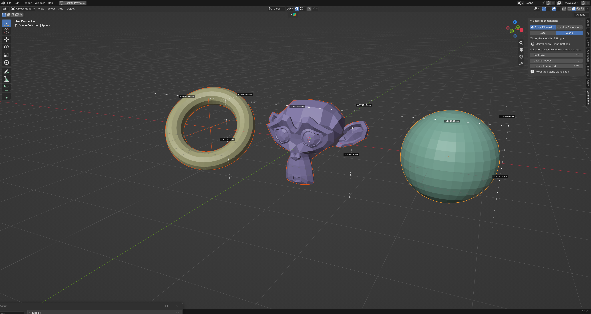

# Selected Dimensions

Blender extension that displays the length, width and height of selected objects and collection instances in the 3D View.

[中文文档](README_CN.md)

## Features

- Measures selected objects only; multiple selections are measured separately.
- Supports collection instances, measuring each selected instance as a whole.
- Switches between local and world coordinates.
- Follows scene units and unit scale, supporting metric and imperial units.
- Chinese / English interface follows Blender language settings.
- Adjustable font size, decimal places and update interval, with cached measurements to reduce repeated work.
- Dimensions are off by default; world coordinates are the default.

## Installation

1. Go to [Releases](https://github.com/hendasheng/selected-dimensions-blender-addon/releases).
2. Download the add-on ZIP starting with `selected_dimensions-` from the latest release.
3. In Blender, open Edit > Preferences > Get Extensions, then choose Install from Disk from the top-right menu.
4. Select the extension ZIP and enable Selected Dimensions.

If you installed the legacy add-on, hide its dimensions, then disable and uninstall it under Add-ons before installing the extension to avoid duplicate registration.

Download the add-on package, not GitHub's automatically generated Source code ZIP.

## Panel Location

3D View > press N to open the Sidebar > Dimensions (translated when using a Chinese interface).

## Usage

1. Select one or more objects or collection instances in Object Mode.
2. Click Show Dimensions.
3. Choose Local or World coordinates and adjust the font size, decimal places and update interval as needed.
4. Click Hide Dimensions to remove annotations; deselecting also hides the corresponding annotations.

## Notes

- Compatible with Blender 5+.
- X, Y and Z represent length, width and height in the chosen coordinate system; they are not sorted by magnitude.
- World mode measures a world-axis-aligned bounding box; Local mode measures along the object's own axes, including scale.
- Annotations are viewport overlays. They do not appear in renders or add text or lines to the model.
- Opening another file turns off annotations. Click Show Dimensions again when needed.
- Initial measurements or geometry changes in complex instances may take longer; increase the update interval if needed.
