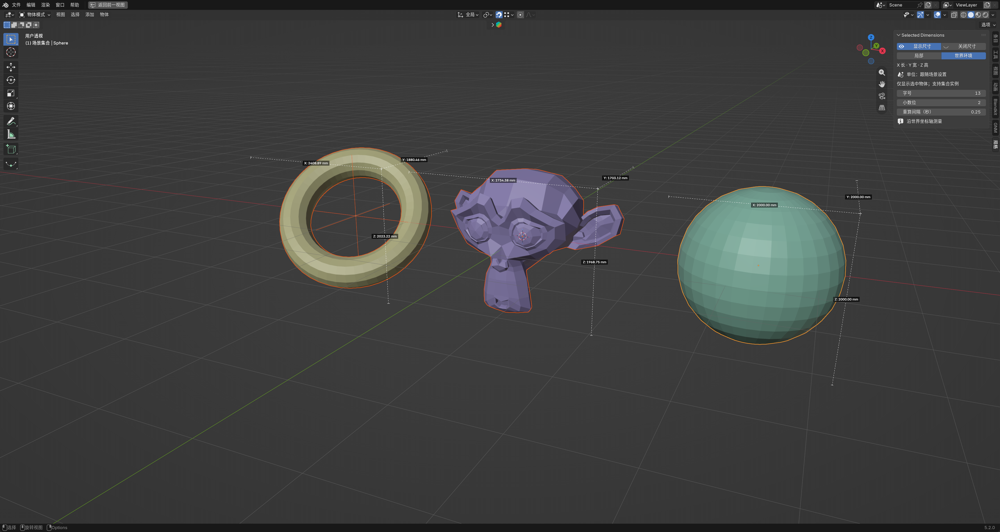

# Selected Dimensions



Blender 插件：在三维视图中显示选中物体和集合实例的长、宽、高。

[English](README.md)

## 功能

- 仅标注选中物体，多选时分别显示。
- 支持集合实例，测量选中实例的整体尺寸。
- 切换物体坐标与世界坐标。
- 单位及单位比例跟随场景设置，支持公制与英制。
- 中文 / 英文界面跟随 Blender 语言。
- 可调整字号、小数位和重算间隔，缓存尺寸以减少重复计算。
- 默认关闭尺寸显示，默认世界坐标。

## 安装

1. 前往 [Releases](https://github.com/hendasheng/selected-dimensions-blender-addon/releases)。
2. 下载 `selected_dimensions-0.1.0.zip` 插件安装包。
3. 在 Blender 打开「编辑 → 偏好设置 → 插件 → 从磁盘安装」。
4. 选择插件 ZIP 并启用 `Selected Dimensions`。

请下载插件安装包，不要使用 GitHub 自动生成的 Source code ZIP。

## 面板位置

三维视图 → 按 N 打开侧栏 → Dimensions（中文界面中为相应翻译）。

## 使用

1. 在物体模式下选择一个或多个模型、集合实例。
2. 点击「显示尺寸」。
3. 根据需要选择物体坐标或世界坐标，并调整字号、小数位和重算间隔。
4. 点击「关闭尺寸」清除标注；取消选择也会隐藏相应标注。

## 注意

- 兼容 Blender 5.0 和 5.2。
- X、Y、Z 分别表示所选坐标系下的长、宽、高，未按大小排序。
- 世界坐标模式显示沿世界轴对齐的包围盒尺寸；物体坐标沿物体自身轴测量并包含缩放。
- 标注为视图叠加，不参与渲染，也不会添加文字或线条到模型中。
- 打开其他文件时关闭标注，需要时重新点击「显示尺寸」。
- 复杂实例首次测量或几何体变化后可能需要较长时间；可增大重算间隔。

## 打包与发布

本地打包（Python 3.10+，无第三方依赖）：

```sh
python scripts/build.py
```

安装包输出到 `dist/selected_dimensions-0.1.0.zip`。版本从插件的 `bl_info` 自动读取。

推送形如 `v0.1.0` 的标签后，GitHub Actions 校验标签与插件版本、打包，并将安装包上传到 GitHub Release。
也可以在 Actions 中手动运行 Package and Release，下载安装包构建产物。

后续发布时先修改 `selected_dimensions/__init__.py` 中的版本号，再提交并推送对应标签。

## 仓库结构

- `selected_dimensions/__init__.py`：插件源文件。
- `scripts/build.py`：版本检查与安装包构建。
- `scripts/test_blender.py`：在 Blender 后台运行的功能验证。
- `.github/workflows/release.yml`：自动打包与发布流程。
- `README_CN.md` / `README.md`：中英文文档。
- `LICENSE`：MIT 许可证。
